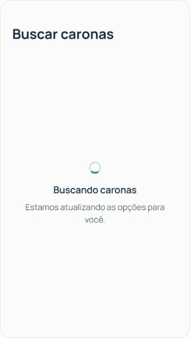
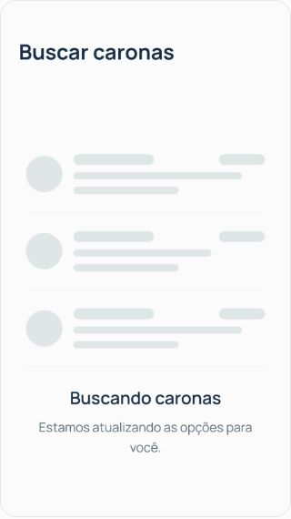
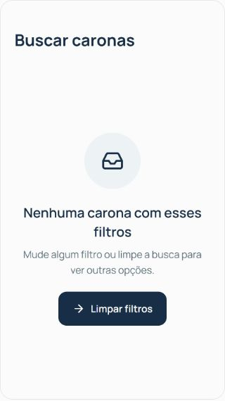
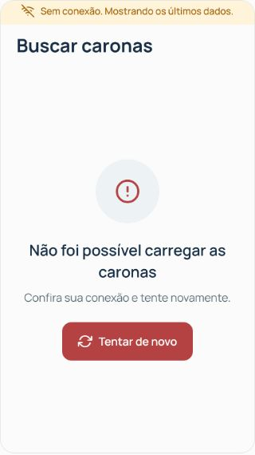

# Componentes de estado

Primeira entrega da [issue #32](https://github.com/joaooopedro/uniride-mobile/issues/32): `EstadoTela` e `FaixaSemConexao`. Os componentes mantêm as props do `CONTRATO.md` e usam o tema ativo do `ThemeProvider`, inclusive a fonte de sistema quando Manrope não estiver disponível.

## `EstadoTela`

```jsx
<EstadoTela
  tipo="erro"
  titulo="Não foi possível carregar as caronas"
  mensagem={erroCaronas}
  acao={{ rotulo: "Tentar de novo", onPress: recarregar }}
/>
```

- `tipo`: `carregando`, `vazio` (padrão) ou `erro`.
- `titulo` e `mensagem`: textos do contexto da tela. Há título padrão para cada tipo.
- `acao`: opcional, com `rotulo` e `onPress`. Enquanto a função assíncrona estiver executando, o botão fica desabilitado e mostra carregamento. Uma falha exibe a mensagem devolvida pela função e libera uma nova tentativa.
- `icone`: opcional, nome de um ícone Feather para personalizar o estado vazio ou de erro. As chamadas existentes não precisam mudar.

O carregamento mostra um esqueleto de três linhas. A pulsação usa `useInterface().podeAnimar`, para quando a preferência muda e é encerrada ao sair do carregamento. Os blocos decorativos ficam ocultos para leitores de tela; o estado anuncia o título e a mensagem.

Vazio e erro têm ícone em círculo, texto e ação opcional com área de toque de pelo menos 48 pontos. O conteúdo pode rolar quando a altura disponível ou o tamanho da fonte exigir.

## `FaixaSemConexao`

```jsx
<FaixaSemConexao visivel={!online} />
```

O componente continua apenas apresentando o aviso. A detecção da conexão permanece na integração existente do app. Quando `visivel` é falso, não renderiza conteúdo. Quando verdadeiro, mostra “Sem conexão. Mostrando os últimos dados.” com as cores de atenção do tema, respeita os insets superiores e laterais e permite quebra de linha.

## Comparação visual

Capturas de uma prévia local dos componentes reais em React Native Web, com Manrope e largura útil de 320 pontos. Não são capturas de aparelho físico.

| Antes | Depois |
| --- | --- |
|  |  |

| Vazio | Erro e aviso sem conexão |
| --- | --- |
|  |  |

## Validação

- Os 48 testes existentes do projeto passaram.
- Seis verificações isoladas dos componentes passaram: anúncio do carregamento, movimento reduzido, encerramento da pulsação, bloqueio durante ação assíncrona, recuperação após falha, visibilidade da faixa e uso da fonte do tema ativo.
- Na prévia: carregando, vazio, erro, execução das ações, botão ocupado e recuperação após erro; texto ampliado em 170% e largura útil de 320 pontos. Nenhum erro ou aviso de execução nos fluxos conferidos.
- Bundle de produção Android gerado pelo Expo. Essa verificação não gera um APK nem substitui o teste no celular.

A validação em Android e iPhone físicos permanece para a integração. Chat, reservas, identidade do app e manual de uso completo continuam nas próximas entregas da #32.
