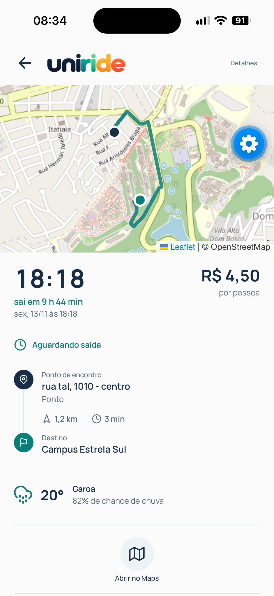
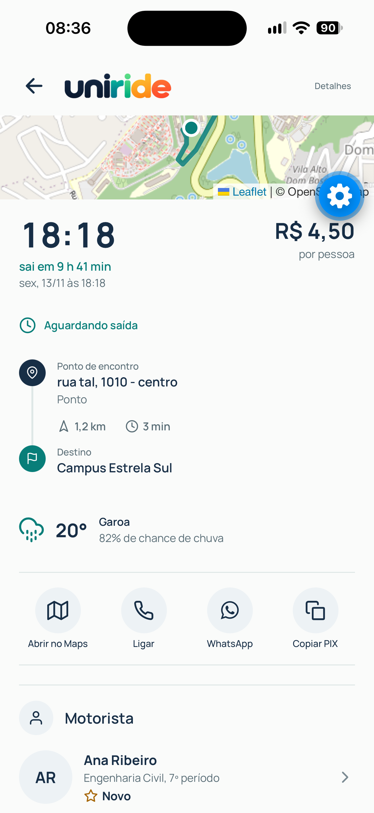
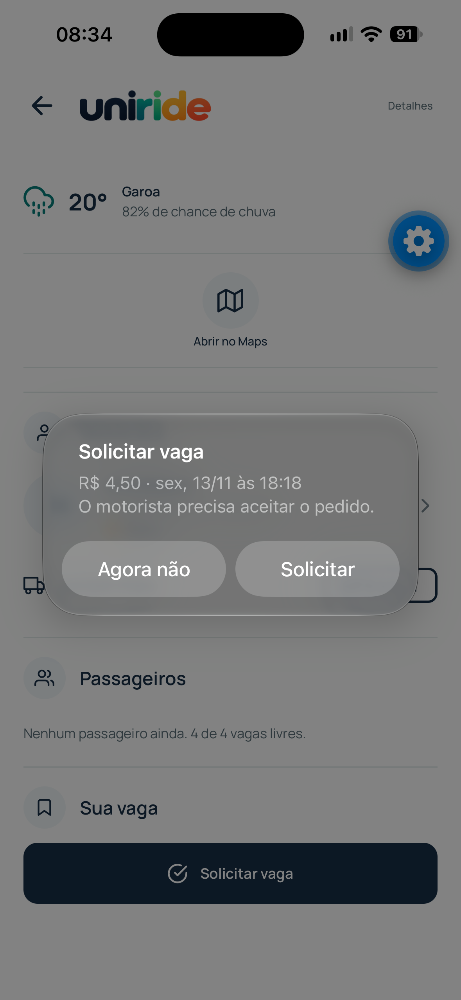
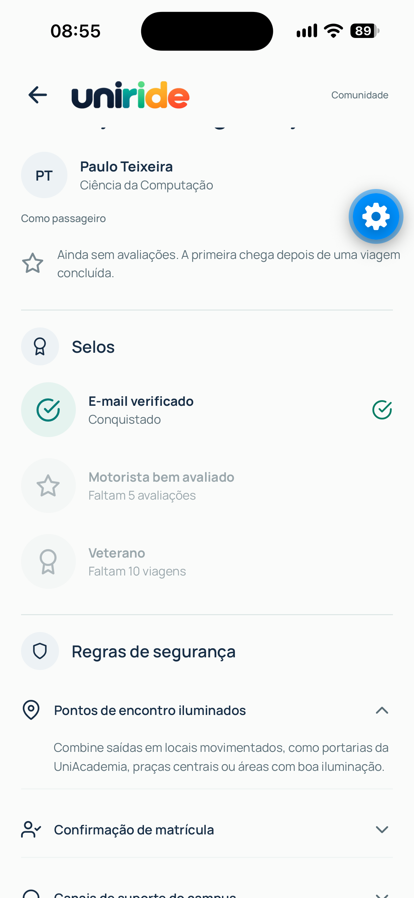
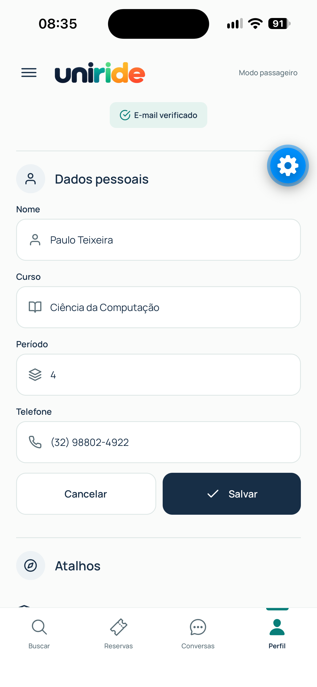
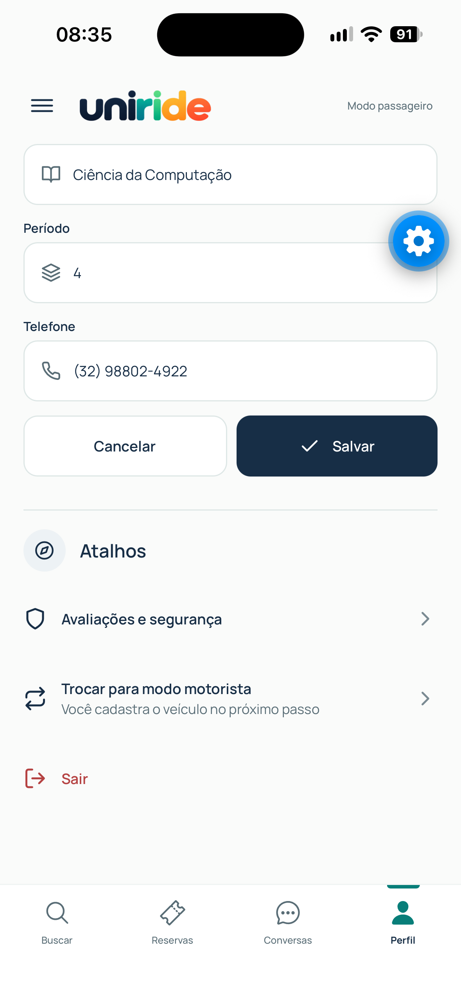

# Manual 03: detalhes da carona, avaliação e perfil

Responsável: Nicolas Isaac. Telas desta parte: Detalhes da carona, Avaliar viagem, Avaliações e segurança, Perfil.

Os prints ficam em `docs/manual/img/`. Cada seção indica o nome do arquivo esperado.

## 1. Ler os detalhes da carona

Toque em qualquer carona (na busca, em Reservas ou em Rotas) para abrir os detalhes.

Da parte de cima para baixo você vê:

- o mapa com o ponto de encontro, o destino e a rota;
- o horário de saída em destaque, quanto falta para sair e o valor por pessoa;
- o status da carona (aguardando saída, em andamento, concluída ou cancelada);
- a linha do tempo com o endereço completo do encontro, a distância e o tempo estimado, e o campus de destino;
- o clima na hora da saída;
- o motorista, o carro, a cor e a placa;
- os passageiros aceitos.

## 2. Mapa e clima

O botão **Abrir no Maps** abre o app de mapas do celular já com o ponto de encontro como destino. No iPhone abre o Apple Maps. No Android abre o app de mapas padrão.

O clima mostra temperatura, chance de chuva e descrição. Sem internet, ou se a previsão falhar, aparece a linha **Previsão indisponível agora** e o resto da tela continua funcionando.

## 3. Solicitar e cancelar vaga

Os botões mudam conforme a situação da sua reserva:

| Situação | O que aparece |
|---|---|
| Sem reserva e com vaga | **Solicitar vaga**. Um aviso mostra valor e horário antes de confirmar |
| Pedido enviado | **Aguardando o motorista** e **Cancelar solicitação** |
| Reserva aceita | **Abrir conversa**, **Cancelar reserva** (com confirmação) e os botões de contato |
| Pedido recusado | Aviso de que o motorista recusou |
| Viagem concluída e não avaliada | **Avaliar viagem** |
| Carona lotada, cancelada ou em andamento | Texto explicando que não aceita novos pedidos |

## 4. Contatar o motorista

Só depois que o motorista aceita o pedido aparecem os botões **Ligar**, **WhatsApp** e **Copiar PIX**. Antes disso o telefone e a chave PIX ficam escondidos.

Para pagar, toque em **Copiar PIX** e cole a chave no app do seu banco.

Se você é o motorista da carona, a tela mostra a lista de reservas com o status de cada passageiro no lugar dos botões de passageiro.

## 5. Avaliar a viagem

A avaliação só abre para viagem concluída e ainda não avaliada.

1. Toque em **Avaliar viagem** nos detalhes.
2. Toque nas estrelas. O texto muda com a nota: Ruim, Regular, Boa, Muito boa ou Excelente.
3. Se quiser, marque os atalhos: Pontual, Dirigiu com cuidado, Educado ou Atrasou.
4. Escreva um comentário de até 280 caracteres. O contador mostra quanto falta.
5. Toque em **Enviar avaliação**. A nota é obrigatória.

## 6. Ver avaliações e selos

Abra pelo Perfil, em **Avaliações e segurança**, ou toque no motorista nos detalhes de uma carona.

A tela mostra a nota média, o total de avaliações, os selos e as regras de segurança.

Os selos são calculados a partir dos seus dados:

- **E-mail verificado**: quando o e-mail da conta foi confirmado.
- **Motorista bem avaliado**: média 4,5 ou mais com pelo menos 5 avaliações.
- **Veterano**: 10 viagens ou mais.

O selo que ainda não foi conquistado aparece apagado e diz o que falta.

## 7. Editar perfil e veículo

Na aba **Perfil**:

1. Em **Dados pessoais**, toque em **Editar**.
2. Altere nome, curso, período ou telefone.
3. Toque em **Salvar**. Os erros aparecem embaixo do campo.

Quem é motorista também vê a seção **Veículo**, com placa, marca, modelo, cor, lugares, validade da CNH e chave PIX. O botão **Editar** funciona do mesmo jeito e usa as mesmas regras do cadastro de motorista.

Os dados ficam salvos na conta e reaparecem quando você abre o app de novo.

## 8. Trocar de modo e sair

Na seção **Atalhos** do Perfil:

- **Trocar para modo motorista** ou **Trocar para modo passageiro** muda as abas do app. Quem ainda não cadastrou o veículo é levado ao cadastro de motorista.
- **Sair** pede confirmação e encerra a sessão.

## O que fica para depois

- Foto de perfil: depende do pacote `expo-image-picker`, que ainda não está instalado. Falta combinar na issue.
- Barras de distribuição por estrelas: dependem de um dado que o contrato ainda não entrega. Quando o perfil trouxer `distribuicaoNotas`, as barras aparecem sozinhas.
